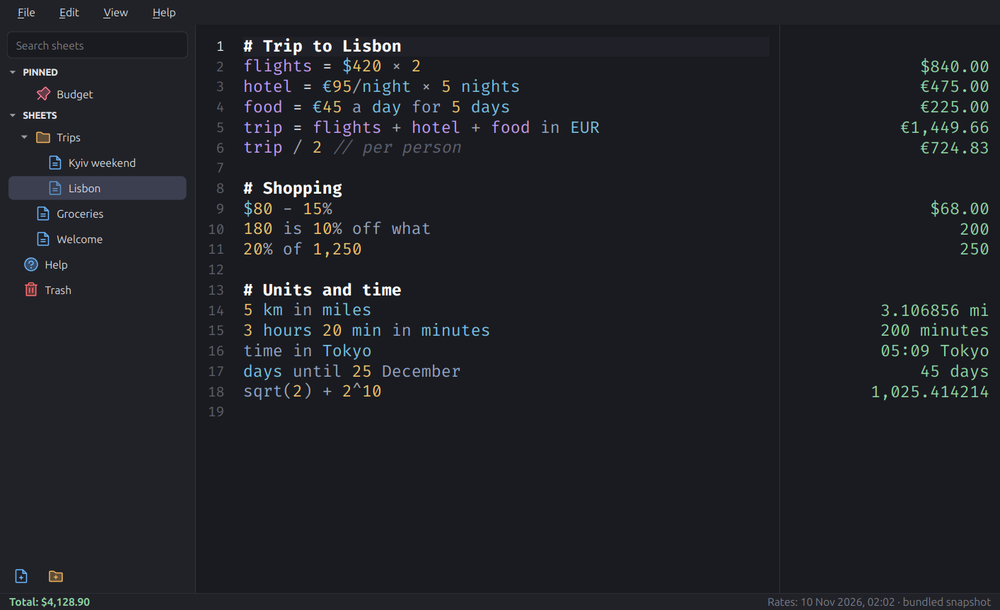

# Calculon

A notepad that calculates as you type. Write plain lines with numbers, money, units and
dates, and the answers show up in a column on the right. The syntax follows
[Soulver's](https://documentation.soulver.app/), so a sheet from one works in the other.

Runs on Linux, Windows and macOS (Intel and Apple Silicon). Built with PySide6.



## Features

- **Words around maths.** `$19 for breakfast + $22 for the uber` → `$41.00`
- **Percentages.** `20% off $80`, `200 + 10%`, `20 is 10% of what`, `50 to 75 is what %`
- **Money.** `100 EUR in USD`, `₴5,000 in €`, `$3k + €2k`, your own rate with
  `50 EUR in USD at 1.05 USD/EUR`. About 160 currencies.
- **Variables.** `rent = $1,900`, then `rent / 3`; `rent += $100`
- **Totals.** A line with `total`, `sum`, `average`, `median` or `count` covers the lines
  above it, up to the previous total or heading. `total of #food` adds tagged lines.
  The status bar shows the sheet total; click it to copy.
- **Units.** `10 km in miles`, `100 °C in °F`, `2 GB in MB`, `20 sq m × 3`, `5 km cast miles`
- **Rates.** `$20/hour × 40 hours`, `$500 at $20/hour`, `$99 per week as / month`,
  `€95/night × 5 nights`. A word used as a rate becomes a unit.
- **Dates and times.** `today + 3 weeks`, `March 3 to May 30`, `days until December 25`,
  `7:45am - 4:20pm`, `time in Tokyo`, `3pm in London`
- **Functions.** `sqrt`, `round(x, 2)` or `round(2,345; 2)`, `floor`, `ceil`, `log`, `ln`, `sin` (with `°`),
  `5!`, `pi`, `255 as hex`, `0b1010`, `1.5e3`, `2.5k`, `5M`
- **Earlier lines.** `line3 * 2`, `prev + 1`, or start a line with `+`, `*` or `/`
- **Comments and headings.** `// comment`, `"quoted text"`, `Label: $120`, `# Heading`,
  `---` starts a new section
- **In Ukrainian.** Everything above has a Ukrainian form: `10% знижки від 200`,
  `20 це 10% від чого`, `1 000 грн у доларах`, `₴500 за годину × 40 годин`,
  `5 тис. грн`, `днів до 25 грудня`, `час у Токіо`, `разом від #їжа`. Function names
  (`sqrt`, `round`, `sin`) stay as in maths. Sheets understand both languages whatever
  the interface language is. With the Ukrainian interface, numbers look like
  `1 234,56`, units and months are in Ukrainian, and the currency sign goes after the
  number.
- Line numbers on the left, so `line12` is easy to find (View → Line Numbers)
- Several sheets with folders, search, pins, drag to reorder and a trash
- Dark theme by default, light theme, or follow the system
- English and Ukrainian interface
- Autocomplete for variables, units and currencies; click an answer to copy it
- Help → Keyboard Shortcuts (Ctrl+?) lists every shortcut

The built-in **Help** sheet in the sidebar has a live example of everything above.

## Sheets

Each sheet is a plain `.txt` file in `~/Documents/Calculon` (change it in Settings).
Folders are real folders, so the sheets work with any sync tool, `grep` or backups.
Calculon keeps pins and custom order in a hidden `.calculon.json` in that folder.
Deleted sheets go to `.trash/` until you empty the trash.

## Exchange rates

Calculon downloads rates once a day from [open.er-api.com](https://open.er-api.com).
If that fails, it uses [Frankfurter](https://frankfurter.dev), which publishes the
European Central Bank's rates. It keeps the last rates for offline use. A snapshot ships with the app, so currencies work on the first
start without a network.

You can point Calculon at your own source in **Settings → Exchange Rates**. The URL must
return JSON like this:

```json
{"base": "USD", "rates": {"EUR": 0.92, "UAH": 41.3, "GBP": 0.79}}
```

- `base`: the currency the rates are relative to (`base_code` also works; defaults to USD)
- `rates`: how many units of each currency one unit of `base` buys
- optional: `time_last_update_unix` (seconds) or `date` (`YYYY-MM-DD`) for the "updated" label

A self-hosted Frankfurter works as is. The only network requests Calculon makes are for
exchange rates.

## Install

Download the archive for your system from the
[releases](https://github.com/sprytnyk/calculon/releases) page and unpack it.

- **Linux.** run `./calculon`.
- **Windows.** run `calculon.exe`. The build isn't code-signed, so SmartScreen may ask
  you to confirm the first start (More info → Run anyway).
- **macOS.** the build isn't notarized. The first time, right-click `calculon` → Open, or
  run `xattr -d com.apple.quarantine calculon`.

Check a download against the signed checksums:

```bash
gpg --verify SHA256SUMS.asc SHA256SUMS && sha256sum --ignore-missing -c SHA256SUMS
```

## Develop

Needs [uv](https://docs.astral.sh/uv/). Python 3.14 is picked from `.python-version`.

```bash
uv sync                 # install dependencies
make run                # start the app
make check              # ruff and pytest
make build              # one-file binary in dist/ (test version)
make icons              # remake assets/icon.png and icon.ico from icon-source.png
```

`dist/calculon --self-test` checks that a build has everything it needs (unit data, time
zones, help sheets, fonts, rates snapshot).

The calculator engine in `calculon/engine/` has no Qt in it; `tests/test_engine.py` has
the examples from Soulver's documentation as tests.

## Release

Pushing a `vX.Y.Z` tag runs the *Release builds* workflow: checks, then one-file builds
for Linux x64, Windows x64, macOS x64 and macOS arm64, kept as a run artifact with
`SHA256SUMS`. The version comes from the tag, and there is no version file. The `release`
skill in `.claude/skills/release/` does the rest: the signed tag, the signed checksums,
the release notes and the GitHub release.

## License

MIT. Fira Code is under the SIL Open Font License (`assets/fonts/OFL.txt`). The menu and
sidebar icons are [Phosphor Icons](https://phosphoricons.com) under the MIT license
(`assets/icons/LICENSE.txt`).

The app icon is **not** MIT: it is Calculon from the *Futurama Calculon* vector logo on
seeklogo.com, which comes with no license grant; the character is © Matt Groening /
Comedy Central (`assets/ICON-LICENSE.txt`). For anything beyond personal use, swap it
for `assets/robot-icon.svg`, the original robot artwork, which is MIT like the rest.
