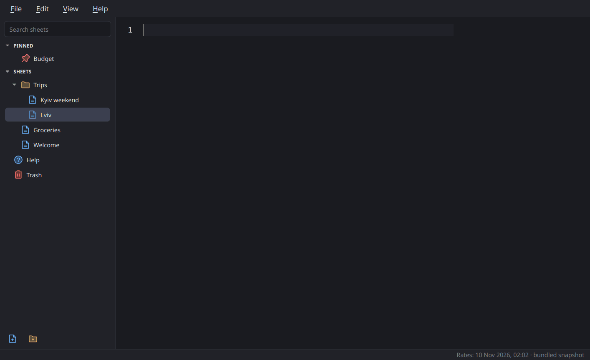

# Calculon

A natural-language notepad calculator. Write plain lines with numbers, money, units and
dates, and the answers show up in a column on the right. The syntax follows
[Soulver's](https://documentation.soulver.app/), so most sheets work in both.



## Features

- Lines mix words and maths: `$19 for breakfast + $22 for the uber`, `20% off $80`,
  `100 EUR in USD`, `10 km in miles`, `today + 3 weeks`
- Variables, totals of the lines above, and answers from earlier lines
- Trip plans with `@from` and `@to`: each stay or leg shows the date it reaches, and `@to`
  says how much time is left before a date. Soulver marks a trip's start and end in its
  window instead, so these lines don't carry over to it
- About 160 currencies, with new rates every day
- English and Ukrainian, in sheets and in the interface
- Linux and Windows x64, and macOS on Intel and Apple Silicon
- Sheets in folders, with search, pins and a trash
- Two themes, Ember and Glacier, each dark, light or following the system
- Spell check for English and Ukrainian on Linux, and on macOS after a manual setup

The Help sheet in the sidebar (F1) shows everything with live examples. Keyboard
Shortcuts in the Help menu lists the keys.

## Install

Download the archive for your system from the
[releases](https://github.com/sprytnyk/calculon/releases) page and unpack it.

- **Linux.** Run `./calculon`.
- **Windows.** Run `calculon.exe`. The build isn't code-signed, so SmartScreen may ask
  you to confirm the first start. Click More info, then Run anyway.
- **macOS.** Pick `macos_arm64` for Apple Silicon or `macos_x64` for Intel, and drag
  `Calculon.app` into Applications. The app isn't notarized, so macOS blocks it the first
  time. Try to open it, then go to System Settings, open Privacy & Security and click Open
  Anyway. Or run `xattr -dr com.apple.quarantine /Applications/Calculon.app`.

Check a download against the signed checksums:

```bash
gpg --verify SHA256SUMS.asc SHA256SUMS && sha256sum --ignore-missing -c SHA256SUMS
```

## Sheets

Each sheet is a plain `.txt` file in `~/Documents/Calculon`. You can pick another folder
in Settings. Folders are real folders, so the sheets work with any sync tool, `grep` or
backups. Calculon keeps pins and custom order in a hidden `.calculon.json` in that
folder. Deleted sheets go to `.trash/` until you empty the trash.

If Calculon can't write to that folder, it starts with a backup folder in its app data
and says why. On Windows that's `%LOCALAPPDATA%\Calculon\Sheets`, and the usual cause is
Controlled folder access in Windows Security. Allow Calculon there, or pick another
folder in Settings.

## Exchange rates

Calculon downloads rates once a day from [open.er-api.com](https://open.er-api.com).
If that fails, it uses [Frankfurter](https://frankfurter.dev), which publishes the
European Central Bank's rates. It keeps the last rates for offline use. A snapshot ships
with the app, so currencies work on the first start without a network.

You can point Calculon at your own source on the Exchange Rates page of Settings. The URL must
return JSON like this:

```json
{"base": "USD", "rates": {"EUR": 0.92, "UAH": 41.3, "GBP": 0.79}}
```

- `base`: the currency the rates are relative to. `base_code` also works. Without
  either, Calculon takes USD.
- `rates`: how many units of each currency one unit of `base` buys.
- Optional: `time_last_update_unix` in seconds, or `date` as `YYYY-MM-DD`. Calculon
  shows it as the time of the last update.

A self-hosted Frankfurter works as is. Calculon makes no network requests other than
for exchange rates.

## Spell check

Turn it on with Check Spelling in the View menu (F7), or in Settings. Calculon draws a wavy line
under misspelled words. Right-click one for suggestions, Add to Dictionary or Ignore.
It skips numbers, units, currencies and variable names, and checks only the words
around them. Words you add go to `words.txt` in Calculon's app data folder, one per
line. On Linux that's `~/.local/share/sprytnyk.dev/Calculon`.

Calculon doesn't ship a spell checker or dictionaries. It uses the Hunspell library and
the dictionaries already on your system. Loading English and Ukrainian takes about a
quarter of a second.

**Linux.** On Debian and Ubuntu:

```bash
sudo apt install libhunspell-1.7-0 hunspell-en-us hunspell-uk
```

Other distros have the same packages under similar names. Calculon looks for
dictionaries in `/usr/share/hunspell`, `/usr/share/myspell`, `~/.local/share/hunspell`
and any folder in `$DICPATH`.

**macOS.** Install Hunspell with [Homebrew](https://brew.sh), then put the dictionaries
in `~/Library/Spelling`:

```bash
brew install hunspell
mkdir -p ~/Library/Spelling && cd ~/Library/Spelling
base=https://raw.githubusercontent.com/LibreOffice/dictionaries/master
curl -LO $base/en/en_US.aff -LO $base/en/en_US.dic
curl -LO $base/uk_UA/uk_UA.aff -LO $base/uk_UA/uk_UA.dic
```

**Windows.** Not yet.

The General page of Settings shows what Calculon found, and the install command for anything
missing. `calculon --self-test` prints it too.

## Develop

Built with PySide6. Needs [uv](https://docs.astral.sh/uv/), which picks Python 3.14 from
`.python-version`.

```bash
uv sync                 # install dependencies
uvx pre-commit install  # ruff and file checks before each commit
make run                # start the app
make check              # ruff and pytest
make build              # dist/calculon, or dist/Calculon.app on macOS (test version)
make icons              # remake assets/icon.png, .ico and .icns from icon-source.png
make site               # remake the website's example sheets and colours in docs/
make gif                # remake docs/demo.gif, the README demo (needs ffmpeg)
```

`dist/calculon --self-test` checks that a build has everything it needs: unit data,
time zones, help sheets, fonts and the rates snapshot. If the system has Hunspell, it
also checks that spell check works. On macOS, run
`dist/Calculon.app/Contents/MacOS/calculon --self-test`.

The calculator engine in `calculon/engine/` has no Qt in it.

The website is plain HTML in `docs/`, served by GitHub Pages from `main`. Its example
sheets get their answers from the engine, and a test fails when they're out of date.

## Release

Pushing a `vX.Y.Z` tag runs the *Release builds* workflow. It runs the checks, then
builds Linux x64 and Windows x64 binaries and a `Calculon.app` for macOS x64 and arm64.
On macOS it installs Hunspell and the dictionaries as described under Spell check, and
the self-test fails if spell check doesn't find both languages. It keeps the builds as
a run artifact with `SHA256SUMS`. The version comes from the tag, and
there is no version file. The `release` skill in `.claude/skills/release/` does the
rest: the signed tag, the signed checksums, the release notes and the GitHub release.

## License

MIT. Fira Code is under the SIL Open Font License, in `assets/fonts/OFL.txt`. The menu
and sidebar icons are [Phosphor Icons](https://phosphoricons.com) under the MIT license,
in `assets/icons/LICENSE.txt`.

The app icon is **not** MIT. It is Calculon from the *Futurama Calculon* vector logo on
seeklogo.com, which comes with no license grant. The character is © Matt Groening /
Comedy Central, as noted in `assets/ICON-LICENSE.txt`. For anything beyond personal
use, swap it for `assets/robot-icon.svg`, the original robot artwork, which is MIT like
the rest.
